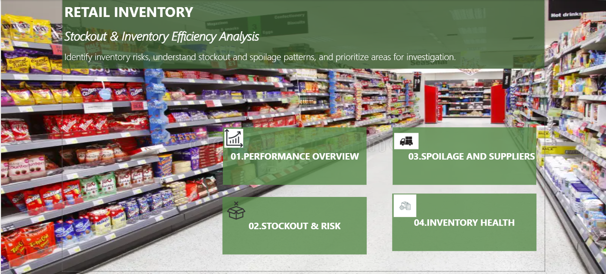
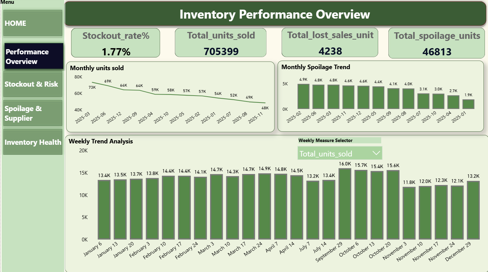
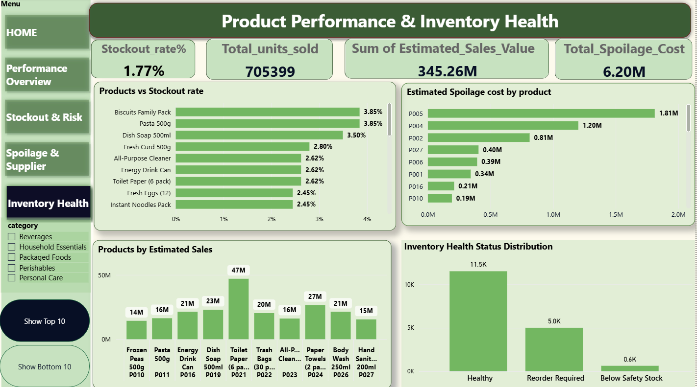
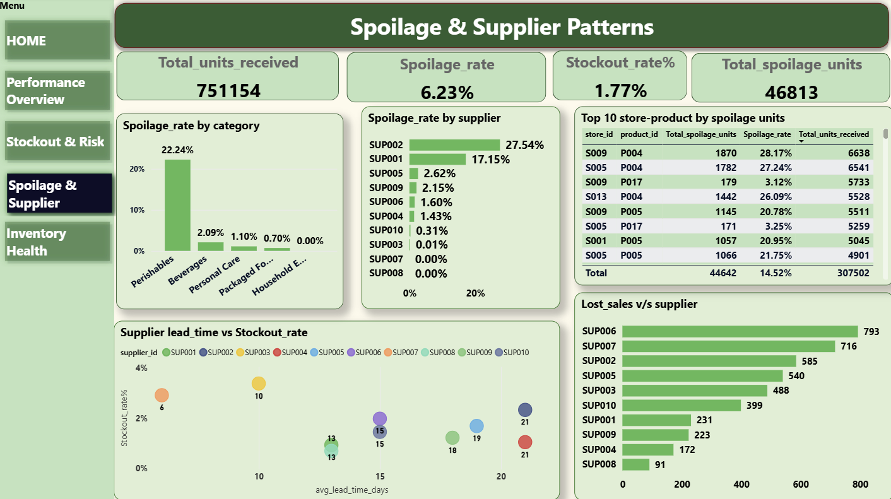
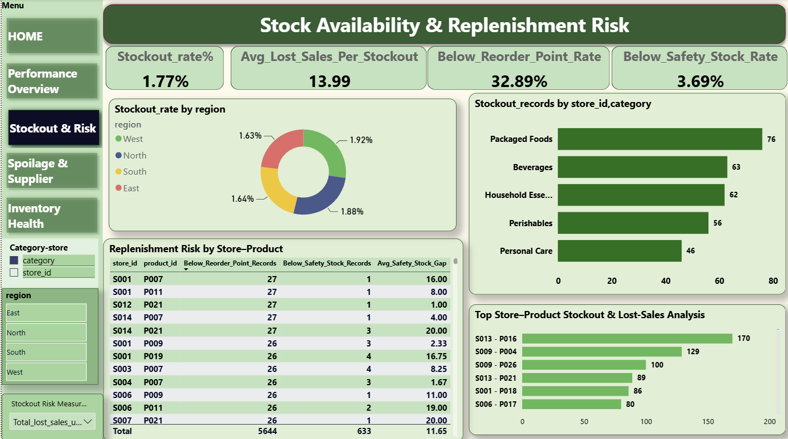
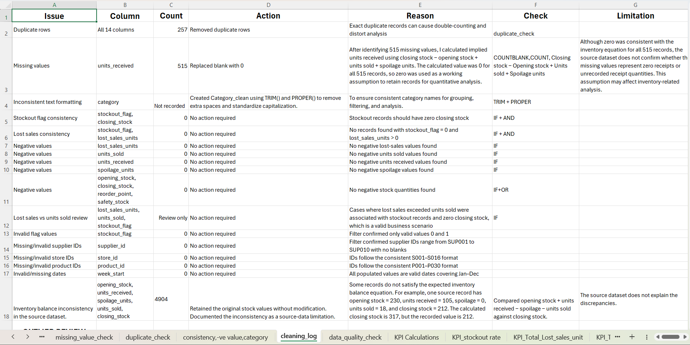
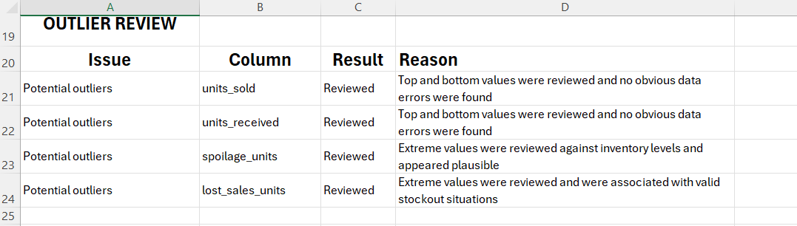
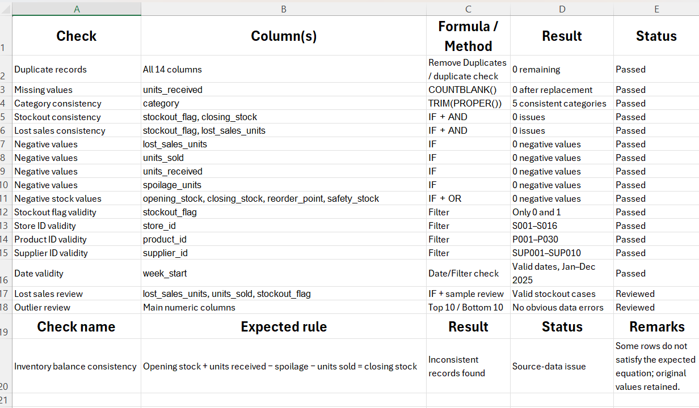
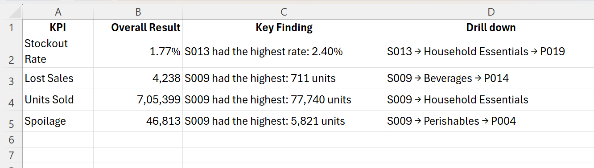
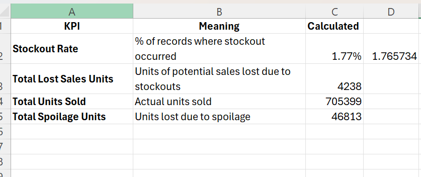

# Retail Stockout & Inventory Efficiency Analysis

A data analytics project analysing retail inventory performance, stockouts, lost sales, spoilage, and supplier efficiency using Excel, SQL, Python (Pandas) and Power BI.

## 1. Project Overview

This project analyses retail inventory data to identify stockout patterns, inventory inefficiencies, lost sales, and product spoilage.

The objective is to transform raw inventory data into meaningful business insights and provide recommendations that can help improve inventory management and replenishment decisions.

## 2. Business Problem

Retail businesses need to maintain sufficient inventory to meet customer demand while avoiding excess stock and product spoilage.

Poor inventory management can result in:
- Stockouts and potential lost sales.
- Excess inventory and increased spoilage.
- Inefficient replenishment decisions.
- Differences in performance across stores, products, and suppliers.

This project uses data analytics to investigate these challenges and identify areas that require attention.

## 3. Project Objectives

- Clean and prepare raw retail inventory data.
- Perform data quality checks and validate the dataset.
- Analyse inventory, sales, stockouts, and spoilage.
- Identify high-risk stores, products, and suppliers.
- Develop interactive dashboards to communicate findings.
- Provide data-driven business recommendations.

## 4. Tools & Technologies

| Tool | Purpose |
|---|---|
| Excel | Data cleaning, quality checks, KPI calculations and pivot-table analysis |
| SQL | Data querying and business analysis |
| Python | Exploratory data analysis |
| Pandas | Data manipulation and analysis |
| Matplotlib | Data visualisation |
| Power BI | Interactive dashboards and DAX measures |

## 5. Project Workflow

1. **Data Collection:** Obtained the retail inventory dataset and supporting product, store, and supplier tables.
2. **Data Cleaning (Excel):** Removed exact duplicates, checked missing values, validated data consistency and performed other data quality checks.
3. **Data Analysis (Excel):** Calculated KPIs and performed pivot-table analysis.
4. **Exploratory Data Analysis (Python):** Used Pandas and Matplotlib to explore inventory trends and patterns.
5. **Business Analysis (SQL):** Developed queries to answer business questions related to inventory performance.
6. **Dashboard Development (Power BI):** Created interactive dashboards using DAX measures and visualisations.

## 6. Dataset & Data Quality

- Initial dataset contained 17,417 records.
- Removed 257 exact duplicate records.
- Final cleaned inventory dataset: **17,160 records**.
- Covered 16 stores, 30 products and 10 suppliers.

Data quality checks included duplicate records, missing values, consistency and negative-value validation.

## 7. Key Performance Indicators (KPIs)

| KPI | Result |
|---|---:|
| Total Inventory Records | 17,160 |
| Stockout Records | 303 |
| Stockout Rate | 1.77% |
| Total Units Sold | 705,399 |
| Total Lost Sales Units | 4,238 |
| Average Lost Sales per Stockout | 13.99 |
| Total Spoilage Units | 46,813 |

## 8. Key Findings & Business Insights

- **Regional Performance:** The West region recorded the highest stockout rate at 1.923%.
- **Supplier Performance:** SUP003 recorded a stockout rate of 3.38%, with a 10-day lead time.
- **Spoilage:** Perishable products recorded a spoilage rate of 22.24%.
- **Supplier Spoilage:** SUP002 recorded a spoilage rate of 27.54%.
- **Product-Level Spoilage:** Store S009 and Product P004 recorded 1,870 spoilage units, with a spoilage rate of 28.17%.
- **Monthly Sales:** March recorded the highest sales at 73,309 units, while November recorded the lowest at 48,276 units.

These findings highlight areas for further investigation in inventory planning, replenishment and supplier performance.

## 9. Business Recommendations

- Review replenishment practices in regions with higher stockout rates.
- Investigate supplier lead times and stockout patterns.
- Monitor perishable products more closely to reduce spoilage.
- Review store-product combinations with consistently high spoilage.
- Use inventory KPIs to support regular stock monitoring and replenishment decisions.

## 10. Power BI Dashboard Preview











## 11. Excel Analysis Preview











## 12. Repository Structure

```text
retail-stockout-inventory-analysis/
│
├── data/
│   ├── raw/
│   └── processed/
│
├── excel/
├── images/
├── power-bi/
├── python/
├── sql/
│
└── README.md
```

## 13. Dataset Source & Acknowledgement

The project uses the `inventory_ledger` dataset from **DataWithSoumya**, along with the supporting product, store and supplier tables.

Dataset source: DataWithSoumya.

Source attribution is provided. Redistribution of the original dataset is subject to the dataset provider's terms and permissions.
--
**Project:** Retail Stockout & Inventory Efficiency Analysis  
**Tools:** Excel | SQL | Python | Pandas | Matplotlib | Power BI
